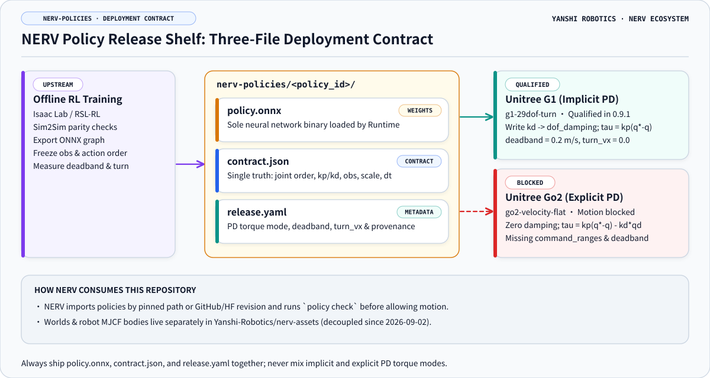

# NERV Policies (`nerv-policies`)

> **Versioned locomotion ONNX policies, deployment contracts, and release manifests for [NERV](https://github.com/Yanshi-Robotics/nerv).**

English | [简体中文](i18n/zh/README.md)

---

## Why a Dedicated Policy Shelf?

Since 2026-09-02, trained locomotion policies live separately from scene and robot-body meshes ([`nerv-assets`](https://github.com/Yanshi-Robotics/nerv-assets)). Scenes and meshes define **geometry and physics**; policies define **trained control weights and actuator invariants**. Keeping them in separate repositories ensures every policy upgrade carries its own immutable SHA-256, observation/action contract, and torque-mode metadata without polluting scene asset commits.

<p align="center">
  
</p>

---

## Three-File Policy Contract

Every policy directory in this repository ships three paired artifacts that MUST travel together:

| File | Role | Authority |
| :--- | :--- | :--- |
| `policy.onnx` | Trained neural policy loaded by the NERV body runtime at 50 Hz | Executable weights (verified by SHA-256) |
| `contract.json` | Single source of truth for joint ordering, default pose, observation layout, action scaling, and timing (`physics_dt_s`, `decimation`, `policy_dt_s`) | Deployment contract |
| `release.yaml` | Deployment facts outside `contract.json`: `pd_mode` (`implicit` vs `explicit`), `command_ranges`, `lin_cmd_deadband`, `turn_vx`, `foot_bodies`, and training provenance | Release manifest |

> [!CAUTION]
> **Never swap `policy.onnx` without its paired `contract.json` and `release.yaml`.**
> Command deadbands, in-place turning behavior (`turn_vx`), and torque mode (`implicit` vs `explicit`) are physical properties of the trained checkpoint. Reusing parameters from another policy causes immediate instability.

### Critical Actuator Invariant: Implicit vs Explicit PD

- **Humanoid (`unitree/g1/dof29`) — `pd_mode: implicit`**: Trained with implicit actuator damping. At deployment, write `kd` into MuJoCo `dof_damping` and send only proportional torque `kp * (q* - q)`. Sending external `-kd * qd` causes high-frequency joint ringing and collapse within ~1 second.
- **Quadruped (`unitree/go2`) — `pd_mode: explicit`**: Trained with explicit PD torque. At deployment, zero model joint damping/friction and compute full external torque `tau = kp * (q* - q) - kd * qd`. Inverting this mode immobilizes or destabilizes the robot.

---

## Published Policy Catalog

| Policy ID | Robot & Family | `pd_mode` | Timing / Dimensions | Command & Turning Facts | `policy.onnx` Size & SHA-256 | NERV 0.9.1 Status |
| :--- | :--- | :--- | :--- | :--- | :--- | :--- |
| [`g1-29dof-turn`](g1-29dof-turn/) | Unitree G1 29-DOF (`humanoid`) | `implicit` | 50 Hz (`dt=0.005s`, `decim=4`) · `obs=480` (hist 5) · `act=29` | `vx [-0.5, 1.0]`, `vy [-0.3, 0.3]`, `wz [-0.8, 0.8]` · **`lin_cmd_deadband=0.2 m/s`** · `turn_vx=0.0` (verified 91.9° in-place in 2.30 s, 0.06 m drift) | 1.6 MB · `07400671...` | **Qualified & active** |
| [`g1-flat-parity-s42`](g1-flat-parity-s42/) | Unitree G1 29-DOF (`humanoid`) | `implicit` | 50 Hz (`dt=0.005s`, `decim=4`) · `obs=480` (hist 5) · `act=29` | `vx [-0.5, 1.0]`, `vy [-0.3, 0.3]`, `wz [-0.8, 0.8]` · `lin_cmd_deadband: null` · `turn_vx: null` (includes schema v2 contract + `evidence/`) | 1.6 MB · `0fd3ee87...` | **Parity reference** (verify deadband & turn behavior before production use) |
| [`go2-velocity-flat`](go2-velocity-flat/) | Unitree Go2 12-DOF (`quadruped`) | `explicit` | 50 Hz (`dt=0.005s`, `decim=4`) · `obs=45` (hist 1) · `act=12` | `turn_vx=0.0` · `command_ranges: null` · `lin_cmd_deadband: null` | 741 KB · `2dd04f0c...` | **Motion blocked** (missing training command ranges & deadband metadata — do not guess) |

### Key Constraints on `g1-29dof-turn`

- **Linear velocity deadband (`0.2 m/s`)**: Training applied a velocity deadband snap; commands in `(0, 0.2]` m/s were never seen during training. Command either `0` or `>= 0.2 m/s`.
- **In-place rotation (`turn_vx = 0.0`)**: Verified on identical start pose with `wz = 0.8 rad/s` for a 90° turn (`turn_vx=0.0`: 91.9° in 2.30 s, 40.0°/s, 0.06 m drift; vs `turn_vx=0.3`: 0.52 m drift).

---

## Integration with NERV

NERV Body nodes reference a policy directory via `${NERV_POLICIES_ROOT}` inside `bodies/<robot>/body.yaml`:

```yaml
skills:
  locomotion:
    policy_dir: "${NERV_POLICIES_ROOT}/g1-29dof-turn"
```

### Verify Policy Integrity Locally

```bash
git clone https://github.com/Yanshi-Robotics/nerv-policies.git
cd nerv-policies
sha256sum g1-29dof-turn/policy.onnx g1-flat-parity-s42/policy.onnx go2-velocity-flat/policy.onnx
```

Compare against the SHA-256 recorded in each directory's `release.yaml`.

---

## NERV Four-Repository Ecosystem

| Repository | Visibility | Role in the Stack |
| :--- | :--- | :--- |
| [**`nerv`**](https://github.com/Yanshi-Robotics/nerv) | Public (Core) | Model-agnostic robot platform: Host, Brain Core, Runtime, World, MCP server, safety interlocks, and CLI |
| [**`nerv-assets`**](https://github.com/Yanshi-Robotics/nerv-assets) | Public | Procedural MuJoCo residential scenes, SO-101 workbenches, and Unitree G1/Go2 robot bodies (zero policy weights) |
| **`nerv-policies`** *(this repo)* | Public | Versioned locomotion ONNX checkpoints, `contract.json` deployment contracts, and `release.yaml` actuator manifests |
| **`nerv-harness`** | Private preview | Standalone multi-agent Swarm host for heterogeneous LLM/VLM orchestration over NERV MCP |

---

## Contributors

Maintained by **Yanshi Robotics** with engineering assistance from **Gemini**, **Codex**, and **DeepSeek Harness**.

## License

See repository metadata and individual policy model cards (`model-card.md`, `release.yaml`) for training provenance and usage terms.
