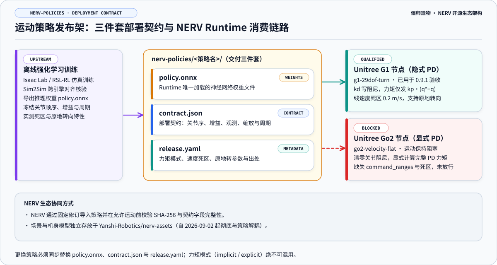

# NERV 策略发布架（`nerv-policies`）

> **面向 [NERV](https://github.com/Yanshi-Robotics/nerv) 的版本化运动策略仓库：ONNX 权重、部署契约（`contract.json`）与发布清单（`release.yaml`）。**

[English](../../README.md) | 简体中文

---

## 为什么把策略单独成仓？

自 2026-09-02 起，训练好的运动策略已与场景及机器人几何模型库（[`nerv-assets`](https://github.com/Yanshi-Robotics/nerv-assets)）彻底解耦：场景与模型仓负责**几何、物理与材质**，策略仓负责**控制权重与执行器约束**。分仓后，每次策略迭代都自带独立的 SHA-256 校验值、观测/动作契约与力矩模式声明，互不污染。

<p align="center">
  
</p>

---

## 三文件部署契约

本仓库每个策略目录都包含三份成对交付的产物，**换策略时必须整体替换**：

| 文件 | 职责 | 地位 |
| :--- | :--- | :--- |
| `policy.onnx` | NERV Body 节点以 50 Hz 加载执行的神经网络权重 | 运行时唯一模型文件（带 SHA-256 校验） |
| `contract.json` | 关节顺序、默认站姿、观测拼接与缩放、动作缩放、控制时序（`physics_dt_s`、`decimation`、`policy_dt_s`） | 部署契约单一真相源 |
| `release.yaml` | 契约之外但部署方必须遵守的客观事实：`pd_mode`（隐式/显式 PD）、`command_ranges`、`lin_cmd_deadband`、`turn_vx`、`foot_bodies` 与训练出处 | 发布清单 |

> [!CAUTION]
> **严禁只替换 `policy.onnx` 而沿用旧版 `contract.json` 或 `release.yaml`。**
> 线速度死区、原地转弯特性（`turn_vx`）和力矩模式（`implicit` / `explicit`）都是该权重自身的客观物理属性，混用参数会导致机器人立刻失稳。

### 核心执行器红线：隐式 PD vs 显式 PD

- **人形机器人（`unitree/g1/dof29`）— `pd_mode: implicit`（隐式 PD）**：训练侧采用隐式执行器阻尼。部署时必须把 `kd` 写入 MuJoCo `dof_damping`，外发力矩只发 `kp * (q* - q)`。若改为外部发送 `-kd * qd`，关节速度从第一步即产生高频振铃并在约 1 秒内倒地。
- **四足机器人（`unitree/go2`）— `pd_mode: explicit`（显式 PD）**：训练侧采用显式 PD 力矩。部署时必须清零模型关节阻尼与库仑摩擦，由控制器显式计算 `tau = kp * (q* - q) - kd * qd`。若与 G1 搞反，狗会原地走不动或抖翻。

---

## 已发布策略清单

| 策略 ID | 机型与类型 | `pd_mode` | 频率 / 维度 | 命令范围与转弯事实 | `policy.onnx` 体积与 SHA-256 | NERV 0.9.1 状态 |
| :--- | :--- | :--- | :--- | :--- | :--- | :--- |
| [`g1-29dof-turn`](../../g1-29dof-turn/) | Unitree G1 29-DOF（`humanoid`） | `implicit` | 50 Hz（`dt=0.005s`, `decim=4`）· `obs=480`（历史 5 帧）· `act=29` | `vx [-0.5, 1.0]`、`vy [-0.3, 0.3]`、`wz [-0.8, 0.8]` · **`lin_cmd_deadband=0.2 m/s`** · `turn_vx=0.0`（实测 91.9° / 2.30 s / 漂移 0.06 m） | 1.6 MB · `07400671...` | **已通过 0.9.1 验收并启用** |
| [`g1-flat-parity-s42`](../../g1-flat-parity-s42/) | Unitree G1 29-DOF（`humanoid`） | `implicit` | 50 Hz（`dt=0.005s`, `decim=4`）· `obs=480`（历史 5 帧）· `act=29` | `vx [-0.5, 1.0]`、`vy [-0.3, 0.3]`、`wz [-0.8, 0.8]` · `lin_cmd_deadband: null` · `turn_vx: null`（含 v2 契约与 `evidence/` 记录） | 1.6 MB · `0fd3ee87...` | **平价对照参考**（上线前须补测死区与原地转弯特性） |
| [`go2-velocity-flat`](../../go2-velocity-flat/) | Unitree Go2 12-DOF（`quadruped`） | `explicit` | 50 Hz（`dt=0.005s`, `decim=4`）· `obs=45`（历史 1 帧）· `act=12` | `turn_vx=0.0` · `command_ranges: null` · `lin_cmd_deadband: null` | 741 KB · `2dd04f0c...` | **0.9.1 运动受阻（未放行）**（缺少训练侧命令范围与死区登记，严禁猜测） |

### `g1-29dof-turn` 实测约束要点

- **线速度死区（`0.2 m/s`）**：训练环境开启了线速度死区吸附，策略从未见过 `(0, 0.2]` m/s 区间。命令线速度只能给 `0` 或 `>= 0.2 m/s`。
- **真正原地转弯（`turn_vx = 0.0`）**：同屋同起点 `wz = 0.8 rad/s` 转 90° 实测，`turn_vx=0.0` 达成 91.9°、耗时 2.30 s、角速度 40.0°/s、前后漂移仅 0.06 m（`turn_vx=0.3` 漂移达 0.52 m）。

---

## NERV 接入与本地校验

NERV 的 Body 节点在 `bodies/<robot>/body.yaml` 中通过 `${NERV_POLICIES_ROOT}` 指向对应策略目录：

```yaml
skills:
  locomotion:
    policy_dir: "${NERV_POLICIES_ROOT}/g1-29dof-turn"
```

克隆并核对本地权重完整性：

```bash
git clone https://github.com/Yanshi-Robotics/nerv-policies.git
cd nerv-policies
sha256sum g1-29dof-turn/policy.onnx g1-flat-parity-s42/policy.onnx go2-velocity-flat/policy.onnx
```

请将输出与对应目录 `release.yaml` 中登记的 `sha256` 逐一核对。

---

## NERV 四仓生态架构

| 仓库 | 可见性 | 在体系中的职责 |
| :--- | :--- | :--- |
| [**`nerv`**](https://github.com/Yanshi-Robotics/nerv) | 公开（核心仓） | 模型无关的机器人平台底座：Host、Brain Core、Runtime、World、MCP 服务端、安全联锁与 CLI |
| [**`nerv-assets`**](https://github.com/Yanshi-Robotics/nerv-assets) | 公开 | 程序化 MuJoCo 住宅场景、SO-101 机械臂工作台与 Unitree G1/Go2 机身资产（不含策略权重） |
| **`nerv-policies`**（本仓库） | 公开 | 版本化运动 ONNX 策略权重、`contract.json` 部署契约与 `release.yaml` 执行器清单 |
| **`nerv-harness`** | 私有预览 | 面向多厂商异构模型协同控制 NERV 机器人的独立多 Agent Swarm 协作宿主 |

---

## 贡献者

由 **偃师造物（Yanshi Robotics）** 维护，**Gemini**、**Codex** 与 **DeepSeek Harness** 协同参与工程建设与文档治理。
